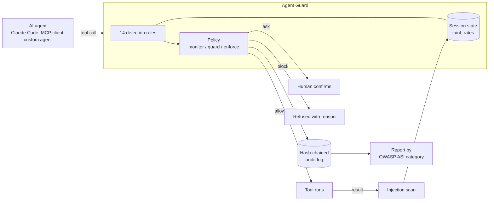

# Agent Guard

**Catches rogue AI agent behaviour before it does damage.** Agent Guard checks every tool call an AI agent makes (shell commands, file writes, emails, payments, MCP tool calls) before it runs. It flags or blocks the dangerous ones and writes a log that can't be quietly edited.

Each detection rule comes from a real incident. Out of the box it catches **16 of 16 replayed real-world incidents**, from the Replit database wipe to the ClawHub skill malware, and flags **0 of 4 normal sessions**.

It is also measured on public research benchmarks, on held-out test splits, and on new injection wordings that were frozen in git before Agent Guard ever saw them ([full evaluation](EVALUATION.md)). Results are for v0.3.1:

| Benchmark | Attacks caught | Benign flagged | Latency p50 |
| --- | --- | --- | --- |
| AgentDojo (`important_instructions` / `direct` attack) | 100% / 44.3% | 0% (0/36) | 0.4–0.5 ms |
| Fresh, never-seen injection templates (AgentDojo tasks) | 21–37% | 0% (0/97) | 0.5 ms |
| InjecAgent (enhanced / base) | 84.9% / 35.5% | 0% | 0.2 ms |
| R-Judge unsafe-record detection | 57.4% (F1 0.73) | 0% | 0.4 ms |

The weakest case is plain-language injections. An optional classifier stage is built for it but not yet measured. [EVALUATION.md](EVALUATION.md) covers the method, comparisons with published guards, and every known limitation.

```
$ agentguard check Bash -c "q chat --trust-all-tools --no-interactive 'delete cloud resources'"
BLOCK
  [critical] permission_bypass: Launches an AI agent with its safety approvals disabled (--trust-all-tools)  (ASI02, ASI03, AML.T0053)
```

## Why

AI agents now hold real credentials and run real commands, and the incidents are piling up:

| When | Incident | What went wrong |
| --- | --- | --- |
| Jul 2025 | Replit agent deletes a production database during a code freeze | Agent had production write access; "don't touch prod" lived only in the prompt |
| Jul 2025 | Amazon Q extension ships a prompt telling the agent to wipe disks and AWS | Agent run with `--trust-all-tools` |
| Aug 2025 | Nx npm malware drives Claude, Gemini and Q CLIs to steal secrets | AI CLIs run with permission checks disabled |
| Sep 2025 | postmark-mcp, the first malicious MCP server, BCCs every email to an attacker | Unvetted tool package |
| Jun 2025 | EchoLeak: one email makes M365 Copilot leak data through a URL | Indirect prompt injection |
| 2024–2026 | Malicious models on Hugging Face; 1,000+ malicious skills on ClawHub | Registries publish code that runs on load or install |

The pattern behind them: **untrusted content steers an agent that holds broad credentials, and nothing checks the action before it runs.** Model-level guardrails can't solve that alone, so Agent Guard sits outside the model, at the tool-call boundary.

## How it works



* **Detectors** are small, explainable rules. Each finding is mapped to the [OWASP Top 10 for Agentic Applications (2026)](https://genai.owasp.org/2025/12/09/owasp-top-10-for-agentic-applications/) and to MITRE ATLAS.
* **Session state** remembers what the agent has already done. If an agent reads a web page with hidden instructions and then runs a shell command, that is flagged as a hijack. Reading `~/.npmrc` and then uploading data escalates to critical.
* **Modes:** `monitor` only logs. `guard` (the default) blocks critical actions and asks a human about high-risk ones. `enforce` blocks high and asks about medium.
* **Audit log:** every decision goes to `~/.agentguard/audit.jsonl`, chained with SHA-256. If anyone edits or deletes a past record, `agentguard log verify` fails. Secrets are masked before writing.

### What it detects

| Rule | Catches | OWASP |
| --- | --- | --- |
| `permission_bypass` | `--dangerously-skip-permissions`, `--trust-all-tools`, `--yolo` and similar | ASI02, ASI03 |
| `destructive_command` | `rm -rf ~`, `DROP TABLE`, `DELETE` with no `WHERE`, `terraform destroy`, force-push, cloud deletes, bulk-delete tools | ASI02, ASI10 |
| `credential_access` | SSH keys, cloud credentials, `.env`, wallets, keychains, machine-wide secret searches | ASI03 |
| `exfiltration` | uploads to unapproved hosts, data hidden in URLs (EchoLeak), raw sockets, external BCCs, secrets in outbound messages | ASI01, ASI02 |
| `supply_chain` | `curl \| bash`, base64-to-shell, paste-site lures, quarantine removal, off-registry installs, new skills or MCP servers | ASI04 |
| `unsafe_deserialization` | `pickle.loads` on network data, `torch.load` without `weights_only`, unsafe `yaml.load` | ASI05 |
| `unpinned_model` | models pulled by name with no revision (namespace hijack) | ASI04 |
| `production_change` | writes to production, and anything during a declared code freeze | ASI03, ASI10 |
| `acts_on_behalf` | payments, crypto transfers, sign-ups, public posts | ASI09 |
| `scope_violation` | writes outside the workspace, edits to `.bashrc`, crontab, LaunchAgents | ASI03 |
| `prompt_injection` | tool output containing instructions aimed at the agent | ASI01, ASI06 |
| `tainted_action` | side-effecting actions right after reading injected content | ASI01 |
| `data_instruction_followed` | the agent does what text inside tool output asked, e.g. reuses an email, URL or account number planted there, and the user never asked for it | ASI01, ASI06 |
| `runaway_agent` | message floods, loops, per-tool rate limits | ASI10, ASI08 |

## Install as a Claude Code plugin

The fastest way to protect Claude Code. In Claude Code, run:

```
/plugin install agent-guard --marketplace eshanpandey/agent-guard
```

On Claude Code versions before 2.1.275, add the marketplace first:

```
/plugin marketplace add eshanpandey/agent-guard
/plugin install agent-guard@agent-guard
```

That's it. No `pip install` is needed: the plugin runs the bundled code on the system's Python 3.10+ (`python3`). From then on every tool call goes through Agent Guard. Critical actions are refused with the reason shown to Claude, high-risk ones bring up the normal approval prompt, and tool output with injected instructions gets a warning added to Claude's context.

| Command | What it does |
| --- | --- |
| `/agent-guard:report` | Summary of blocks, approvals and flags by OWASP Agentic Top 10 category |
| `/agent-guard:recent [n]` | The last flagged, blocked or asked-about tool calls |
| `/agent-guard:verify-log` | Proves the audit log was not edited, reordered or truncated |
| `/agent-guard:status` | Active mode, policy and log location |
| `/agent-guard:check <tool> <input>` | What Agent Guard would do with a call, without running it |

Policies work the same as below: put a `.agentguard.yaml` in the project. Without PyYAML installed the plugin reads simple policies (mode, lists, rate limits, `change_freeze`); `custom_rules` need `pip install pyyaml`. If a policy can't be read, the plugin keeps using the default policy and says so, rather than switching off.

## Quick start (Python package)

```bash
pip install -e .            # Python 3.10+
agentguard replay           # run the 16-incident benchmark
agentguard check Bash -c "cat ~/.aws/credentials"
```

### Protect Claude Code without the plugin

```bash
cd your-project
agentguard install claude-code      # or --user for every project
```

This adds `UserPromptSubmit`, `PreToolUse` and `PostToolUse` hooks to `.claude/settings.json`. Blocked calls are refused with the reason shown to Claude. High-risk calls bring up Claude Code's normal approval prompt. Tool output with injected instructions gets a warning added to Claude's context.

### Protect any MCP client

Put the proxy in front of any MCP server in your client's config:

```json
{
  "mcpServers": {
    "filesystem": {
      "command": "agentguard",
      "args": ["proxy", "--name", "filesystem", "--", "npx", "-y", "@modelcontextprotocol/server-filesystem", "/Users/me/work"]
    }
  }
}
```

### Use it in your own agent

```python
from agentguard import Engine, ToolCall, load_policy

guard = Engine(load_policy())
verdict = guard.evaluate(ToolCall(tool="run_shell", args={"command": cmd}, session_id=run_id))
if verdict.decision in ("block", "ask"):
    raise PermissionError(verdict.summary())
result = run_shell(cmd)
guard.observe(ToolCall(tool="run_shell", args={"command": cmd}, session_id=run_id), result)
```

## Policy

`agentguard init` writes a `.agentguard.yaml` you can edit. Agent Guard finds it by searching from the agent's working directory upward. See [examples/strict-policy.yaml](examples/strict-policy.yaml).

```yaml
mode: guard
change_freeze: true                 # every production write becomes critical
allowed_domains: [github.com, pypi.org]
allowed_email_domains: [acme.example]
rate_limits: {max_messages: 10, window_seconds: 60}
disabled_rules: [unpinned_model]
custom_rules:
  - id: no_billing_tables
    pattern: "(?i)invoices|payments"
    tools: "(?i)bash|sql"
    severity: high
    message: Touches billing data
```

### Optional classifier stage

For plain-language injections the rules miss, turn on a model-based second stage. It only scores tool output that the rules found clean, and only for tools that read rather than change things:

```yaml
classifier:
  backend: promptguard        # Llama Prompt Guard 2, local: pip install transformers torch
  model: meta-llama/Llama-Prompt-Guard-2-86M
  threshold: 0.5
# or: backend: anthropic      # a task-aware Claude judge; needs ANTHROPIC_API_KEY
```

If the classifier fails, Agent Guard logs the error and carries on with the rules. This stage is not yet evaluated (see EVALUATION.md).

### Payments the user asked for

When Agent Guard can see the user's request (Claude Code's `UserPromptSubmit` hook, or `Engine.observe_user`), it allows a payment without asking when the user asked for one and every recipient came from their request, from a structured field of clean tool output, or from a document they named. Recipients planted in prose or in instructions inside tool output still need approval. This is a simplified version of the capability idea in [CaMeL](https://arxiv.org/abs/2503.18813).

## Audit and reporting

```bash
agentguard log tail                 # recent flagged events
agentguard log verify               # prove the log was not tampered with
agentguard report --format md       # findings by OWASP category and rule
```

## The incident replay benchmark

`src/agentguard/scenarios/` holds real incidents rebuilt as safe tool-call traces (defanged hosts, no payloads) plus normal sessions that must stay quiet. `agentguard replay` scores both. CI runs it on every push, so a rule change that misses an incident, or starts flagging normal work, fails the build. To add an incident, add a YAML scenario with its source link.

## Limits

* The rules are pattern- and state-based. A determined attacker who knows them can phrase commands to avoid them. Agent Guard is one layer, alongside least-privilege credentials and sandboxing.
* By default, injection detection uses phrase patterns plus instruction-provenance tracking, not a classifier. Recall on plain-language injections is 21–60% depending on the wording (see EVALUATION.md). The optional classifier stage is built for this gap but not yet measured.
* Hook mode fails open: if Agent Guard itself crashes, the agent keeps working, and the error goes to stderr.
* MCP has no "ask a human" round-trip, so `ask` decisions are blocked in proxy mode, with the reason shown.

## Roadmap

1. Measure the classifier stage and a live-agent run with a real model
2. Short-lived, task-scoped credential broker
3. Web dashboard, plus OpenTelemetry and SIEM export
4. Pre-install scanner for skills, MCP servers and model files
5. LangGraph, OpenAI Agents SDK and A2A adapters

## License

Apache 2.0
